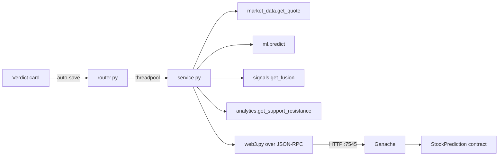
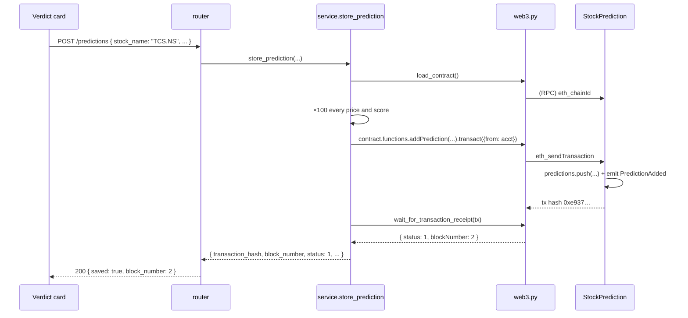
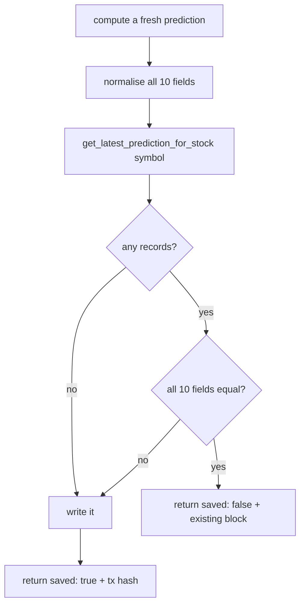
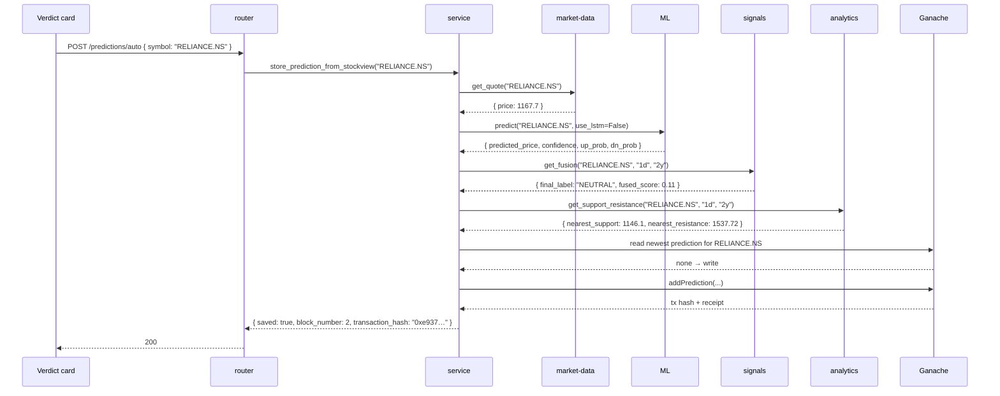
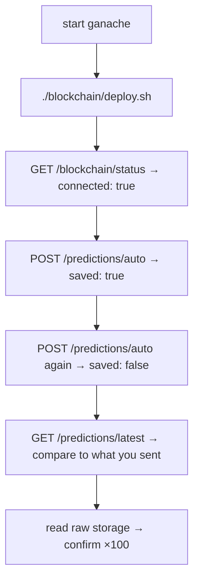

# Blockchain — how it works

This page walks through the write path, the ×100 scaling, the duplicate
check, the auto-save pipeline, and what happens when the chain is down.

## The big picture



The router never calls web3 directly. It hands the whole job to the
service, which either returns a result or raises — and the router turns
raises into HTTP status codes.

## Connecting

Two steps, both in `service.py`.

### Step 1 — is the node reachable?

```python
web3 = Web3(Web3.HTTPProvider(settings.blockchain_rpc_url))

if not web3.is_connected():
    raise ConnectionError(
        f"Could not connect to Ganache at {settings.blockchain_rpc_url}"
    )
```

`is_connected()` is a real JSON-RPC ping, not a socket check. If Ganache
is down it raises `ConnectionError`, which the router maps to `503`.

### Step 2 — bind the contract

```python
if not settings.blockchain_contract_address:
    raise ValueError("Blockchain contract address is not configured.")

abi = json.loads(ABI_PATH.read_text())["abi"]

contract = web3.eth.contract(
    address=Web3.to_checksum_address(settings.blockchain_contract_address),
    abi=abi,
)
```

`to_checksum_address` matters. Ethereum addresses are hex, and a mixed-case
address is a checksum — one flipped letter means a different address.
web3.py rejects a bad checksum instead of silently sending funds to the
wrong place.

The ABI is the compiled contract interface, committed at
`abi/StockPrediction.json`. Truffle writes it during deploy; the backend
reads it rather than hand-writing the function signatures.

If the address is empty, `ValueError` → `422`. If it points at an address
with no code (stale, after a Ganache restart), the `.call()` reverts →
`502`.

## Writing a prediction



Steps 5–7 are all network round-trips. The receipt wait is what makes the
response trustworthy — `transact` returning a hash only means the node
accepted it, not that it succeeded.

### The scaling, in code

```python
contract.functions.addPrediction(
    stock_name,                                  # string, as-is
    round(current_price * 100),                  # uint256
    round(predicted_price * 100),                # uint256
    direction,                                   # string, as-is
    round(confidence),                           # uint256 — already %
    round(up_probability),                       # uint256 — already %
    round(down_probability),                     # uint256 — already %
    round(signal_score * 100),                   # int256 — signed
    round(stop_loss * 100),                      # uint256
    round(target_price * 100),                   # uint256
)
```

Note which fields are **not** multiplied: `confidence`, `upProbability`,
`downProbability`. They are already 0–100 percentages, so ×100 would make
them 0–10000 and break the read path.

`round()` is called without a second argument, so Python returns an `int`.
`int(round(x))` would be redundant — `round` of a float *is* an int, and
so is `round` of a `numpy.float64`.

### Reading it back

```python
prediction = contract.functions.getPrediction(index).call()

{
    "stock_name":      prediction[0],       # string
    "current_price":   prediction[1] / 100, # undo ×100
    "predicted_price": prediction[2] / 100,
    "direction":       prediction[3],
    "confidence":      prediction[4],       # no division
    "up_probability":  prediction[5],
    "down_probability":prediction[6],
    "signal_score":    prediction[7] / 100,
    "stop_loss":       prediction[8] / 100,
    "target_price":    prediction[9] / 100,
    "timestamp":       prediction[10],
}
```

Solidity's public array getter returns a **tuple, not a struct** — hence
the positional indexes. The order matches the struct field order in
`StockPrediction.sol`, so index 7 is always `signalScore`.

The ÷100 has to match the ×100 on the way in, field for field. Getting
one wrong is the easiest bug in this module; it is also the one the
manual check in the next section catches.

## The duplicate check

This is the part worth understanding.



`get_latest_prediction_for_stock` walks **backwards** from the newest
prediction:

```python
for index in range(count - 1, -1, -1):
    prediction = contract.functions.getPrediction(index).call()

    stored_name = str(prediction[0]).strip().upper()
    if stored_name != normalized_stock_name:
        continue

    # found the newest record for this symbol — compare the rest
    return { ... }
```

`range(count - 1, -1, -1)` counts down, so the **first** match is the
newest one for that symbol. An older matching record never gets compared.

### Why the comparison is exact

The chain stores integers. The comparison rounds both sides to the same
precision before comparing:

```python
round(latest["current_price"], 2) == normalized_current_price
```

So ₹1167.70 stored as `116770` reads back as `1167.7`, rounds to
`1167.7`, and matches. A genuine move to ₹1167.71 gives `116771`, reads
back `1167.71`, and does **not** match — so it is written.

### Why it skips the block lookup on a miss

On a duplicate the response still wants a `block_number`. The struct does
not store one, so the service reads it back from the event:

```python
events = (
    contract.events.PredictionAdded()
    .get_logs(from_block=0, to_block="latest",
              argument_filters={"predictionId": index})
)
block_number = events[-1]["blockNumber"]
```

This is wrapped in `try/except Exception` with `block_number = None` as
the fallback — a missing block number is cosmetic, and it should never
turn a successful duplicate check into a `502`.

## The auto-save pipeline

`store_prediction_from_stockview` is the only endpoint the UI calls. It
does not accept prices — it gathers them.



Key points:

- **`use_lstm=False`.** The LSTM is the slow path (30–60s) and the
  gradient-boosting ensemble is what the fusion verdict actually uses.
  Asking for the same numbers the verdict card is already showing keeps
  the two consistent.
- **The fallbacks are not optional.** If ML returns no price, use the
  current price. If analytics has no support level, use `price × 0.98`
  and `price × 1.03`. A record with holes in it is worse than one with an
  approximate stop-loss.
- **The 4 calls are sequential, not parallel.** They could overlap, but
  ML and fusion both hit the same cached market history, so running them
  at once buys little and complicates the rate-limit story.

### Why it is slow the first time

A cold auto-save takes **~3 minutes**. Almost all of it is upstream:
yfinance history fetch, the ML ensemble fit, the FinBERT sentiment load.
With the cache warm the same call takes **~6 seconds**.

The second duplicate check above is also slower than it looks — it is one
`getPrediction` call per record walked.

## Threading

web3.py is **blocking**. Calling `.call()` or waiting for a receipt inside
an `async def` handler stalls the whole event loop — every other request
in flight waits for the chain.

Both paths fix it the same way the rest of the codebase does:

```python
# blocking path — router
result = await run_in_threadpool(service.get_blockchain_status)

# inside the async pipeline
latest = await anyio.to_thread.run_sync(
    get_latest_prediction_for_stock, symbol
)
```

`anyio.to_thread.run_sync` is the convention in `market_data`, `ml`,
`signals`, `sentiment`, `analytics`, `smc` and `backtesting`, so this
module uses it rather than inventing something new.

## Error mapping

The service raises ordinary Python exceptions. The router converts them,
via a shared `_map_chain_errors` context manager, so callers get a
status code and a message instead of a stack trace.

| Raised | Status | When |
|---|---|---|
| `ConnectionError` | `503` | Ganache not running / not reachable |
| `ValueError` | `422` | contract address not configured |
| anything else | `502` | revert, no code at address, RPC error |
| `HTTPException` | *passes through* | e.g. the `404` for an empty chain |

```python
with _map_chain_errors():
    result = await service.store_prediction_from_stockview(payload.symbol)
```

The client (`frontend/lib/api/client.ts`) reads `body.detail`, so the
message reaches the UI intact.

## Verifying it by hand

There is no `test_blockchain.py`. The walkthrough below is the check.



**Step 7 is the one that catches scaling bugs.** Read the struct directly
and check the integers:

```python
p = contract.functions.getPrediction(0).call()
assert p[1] == 116770      # current_price 1167.70 × 100
assert p[7] == 11          # signal_score 0.11 × 100  (signed, small)
assert p[9] == 153772      # target_price 1537.72 × 100
```

If `p[1]` is `1167` the ×100 is missing on the write. If it is
`116770000` the multiply ran twice. Both look fine in the JSON response
if the read path divides by the same wrong factor, which is exactly why
the raw read matters.

## What can go wrong

| Symptom | Cause | Fix |
|---|---|---|
| `503 Could not connect to Ganache` | Node is down | `docker compose up -d ganache` |
| `422 ... not configured` | `SV_BLOCKCHAIN_CONTRACT_ADDRESS` empty | run `blockchain/deploy.sh` |
| `502 no code at given address` | Address is stale after a Ganache restart | re-run `deploy.sh` |
| `404 No blockchain predictions found` | Chain is empty | write one first |
| Chain stuck at block 0 | Deployed but never wrote | normal — deploy is block 1 |
| Same tx hash after a restart | Ganache replayed the deterministic chain | expected, not a bug |
| Prediction writes but UI shows "unavailable" | Blockchain error swallowed by the card | check the browser console |
| Auto-save takes minutes | Cold ML / yfinance cache | wait; second call is ~6s |
| `web3` not installed | Installed from `requirements.txt` on an old venv | `pip install -e ".[dev]"` |

Related: [implementation](implementation.md) for the file map and the
full function list.
