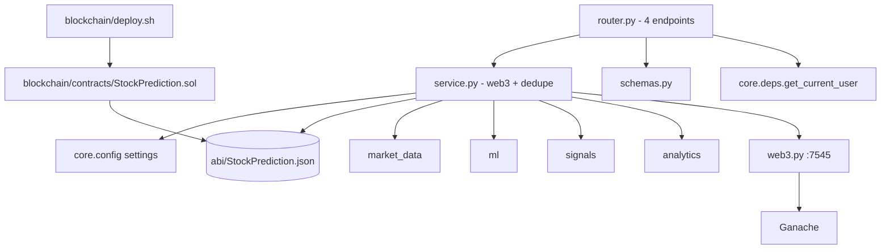
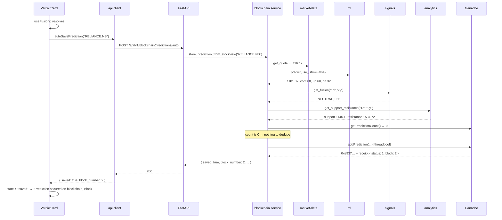
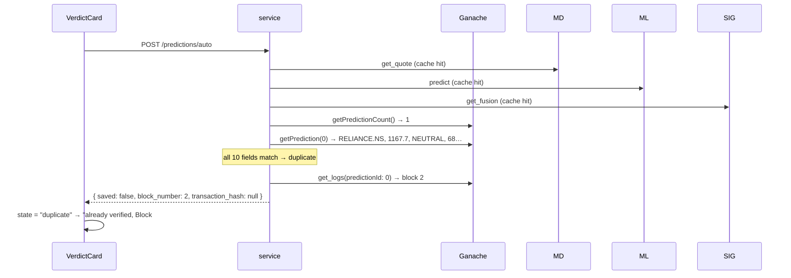

# Blockchain — implementation (reading the code)

A guide for someone with the repo open. Read in this order.

## File map



`blockchain/` lives at the **repo root**, not inside `backend/`. Truffle
expects to be run from its own directory (`truffle-config.js` is
discovered by walking up from cwd), and the deploy script shells out to
it. Keeping it separate also means `pip install` never walks into
`node_modules`-adjacent tooling.

## 1. `blockchain/contracts/StockPrediction.sol` (125 lines)

```solidity
struct Prediction {
    string  stockName;
    uint256 currentPrice;      // ×100
    uint256 predictedPrice;    // ×100
    string  direction;
    uint256 confidence;
    uint256 upProbability;
    uint256 downProbability;
    int256  signalScore;       // ×100, signed
    uint256 stopLoss;          // ×100
    uint256 targetPrice;       // ×100
    uint256 timestamp;
}

Prediction[] public predictions;

event PredictionAdded(
    uint256 indexed predictionId,
    string stockName,
    string direction,
    uint256 currentPrice,
    uint256 predictedPrice,
    uint256 confidence,
    uint256 timestamp
);
```

Three design choices worth knowing:

- **`Prediction[] public`** — Solidity generates a `predictions(uint256)`
  getter returning the full tuple. The backend uses the explicit
  `getPrediction` instead, which is the same data with a named signature
  and a documented return order.
- **`signalScore` is `int256`.** The fusion score is −1.0…+1.0. A
  `uint256` would make any negative verdict uncallable.
- **No `onlyOwner`.** `addPrediction` is `public` with no access control,
  so on a real chain anyone could write. For a local demo chain that is
  a feature — the backend just uses `accounts[0]` with no key management.
  Production would add a modifier.

There is no `updatePrediction` and no `deletePrediction`. Immutability is
the product.

## 2. `backend/app/modules/blockchain/service.py` (508 lines)

| Function | Sync? | What it does |
|---|---|---|
| `get_web3()` | Yes | Builds `Web3(HTTPProvider(rpc_url))`, raises `ConnectionError` if not connected |
| `load_contract()` | Yes | `get_web3` + empty-address check + checksum + ABI bind → `(web3, contract)` |
| `get_blockchain_status()` | Yes | chain id, latest block, first account, contract address |
| `store_prediction(...)` | Yes | ×100 scale, `transact`, wait for receipt → tx hash + block + status |
| `get_latest_prediction()` | Yes | Newest record on the **whole chain**, or `None` |
| `get_latest_prediction_for_stock(symbol)` | Yes | Reverse scan for the newest record **matching that symbol** |
| `store_prediction_from_stockview(symbol)` | **Yes (async)** | The whole pipeline: 4 upstream calls → normalise → dedupe → write |

Everything except the last one is sync, because web3.py is blocking. The
async one awaits the four upstream modules and offloads the blocking bits
with `anyio.to_thread.run_sync`.

### Section A — the offload points

Three calls inside `store_prediction_from_stockview` are blocking and
must not run on the event loop:

```python
latest = await anyio.to_thread.run_sync(
    get_latest_prediction_for_stock, symbol
)
# ...
blockchain_status = await anyio.to_thread.run_sync(get_blockchain_status)
# ...
result = await anyio.to_thread.run_sync(
    lambda: store_prediction(
        stock_name=symbol, current_price=current_price, ...
    )
)
```

`store_prediction` has ten keyword parameters, so it needs the `lambda`.
The other two take one positional argument and can be passed directly.

### Section B — the normalise step

```python
normalized_current_price   = round(current_price, 2)
normalized_predicted_price = round(float(predicted_price), 2)
normalized_confidence      = round(confidence)
normalized_up_probability  = round(up_probability)
normalized_down_probability= round(down_probability)
normalized_signal_score    = round(signal_score, 2)
normalized_stop_loss       = round(stop_loss, 2)
normalized_target_price    = round(target_price, 2)
```

These exist so the duplicate comparison and the on-chain value agree.
`round(x, 2)` on the prices, plain `round()` on the percentages, because
that is how each one is scaled on the way in.

### Section C — the duplicate comparison

Nine chained equality checks plus the symbol, all must pass:

```python
is_duplicate = (
    latest["stock_name"].strip().upper() == symbol
    and round(latest["current_price"], 2) == normalized_current_price
    and round(latest["predicted_price"], 2) == normalized_predicted_price
    and latest["direction"] == direction
    and latest["confidence"] == normalized_confidence
    and latest["up_probability"] == normalized_up_probability
    and latest["down_probability"] == normalized_down_probability
    and round(latest["signal_score"], 2) == normalized_signal_score
    and round(latest["stop_loss"], 2) == normalized_stop_loss
    and round(latest["target_price"], 2) == normalized_target_price
)
```

Note the asymmetry: prices get `.strip().upper()` and `round()`, but
`direction` and the three percentages are compared raw. That is correct —
they are already normalised on write — but it means the read side must
apply the same rounding, and it does, because those fields come back as
the integers that were stored.

On a duplicate the response is built from the existing record:

```python
if is_duplicate:
    blockchain_status = await anyio.to_thread.run_sync(get_blockchain_status)
    return {
        "saved": False,
        "message": "Prediction already stored on blockchain.",
        "transaction_hash": None,
        "block_number": latest.get("block_number"),
        "status": 1,
        "contract_address": blockchain_status["contract_address"],
        "sender": blockchain_status["account"],
    }
```

`transaction_hash` is `None` because nothing was sent. `block_number`
comes from the event log and may be `None` if that lookup failed.

## 3. `backend/app/modules/blockchain/router.py` (118 lines)

Four endpoints under `/api/v1/blockchain`. The router itself carries
`dependencies=[Depends(get_current_user)]`, so **every** one of them
requires a session.

| Method | Path | Handler | Response |
|---|---|---|---|
| `GET` | `/status` | `blockchain_status` | `BlockchainStatusResponse` |
| `POST` | `/predictions` | `save_prediction` | `BlockchainPredictionResponse` |
| `POST` | `/predictions/auto` | `auto_save_prediction` | `BlockchainAutoSaveResponse` |
| `GET` | `/predictions/latest` | `latest_prediction` | `BlockchainLatestPredictionResponse` |

### `_map_chain_errors`

```python
@contextmanager
def _map_chain_errors() -> Iterator[None]:
    try:
        yield
    except HTTPException:
        raise
    except ConnectionError as exc:
        raise HTTPException(status_code=503, detail=str(exc)) from exc
    except ValueError as exc:
        raise HTTPException(status_code=422, detail=str(exc)) from exc
    except Exception as exc:
        raise HTTPException(
            status_code=502, detail=f"Blockchain call failed: {exc}",
        ) from exc
```

Two details worth keeping:

- **`except HTTPException: raise` first.** Without it the catch-all would
  re-wrap the `404` from `latest_prediction` into a `502` and lose the
  original status.
- **One context manager, two call sites.** `_run_chain` wraps the
  threadpool call; `auto_save_prediction` wraps its own await. Sharing it
  is why the two paths cannot drift apart.

### `_run_chain`

```python
async def _run_chain[T](fn: Callable[[], T]) -> T:
    with _map_chain_errors():
        return await run_in_threadpool(fn)
```

PEP 695 type parameters (`def _run_chain[T](...)`, not a `TypeVar`) so
`T` stays local to the function. Python 3.12+ only — consistent with
`python_version = "3.12"` in `pyproject.toml`.

Used by three handlers. `auto_save_prediction` does **not** use it,
because `store_prediction_from_stockview` is already async and does its
own offloading internally.

## 4. `backend/app/modules/blockchain/schemas.py` (63 lines)

| Schema | Shape |
|---|---|
| `BlockchainPredictionRequest` | 10 fields, all `float` except `stock_name` and `direction` |
| `BlockchainPredictionResponse` | `{ transaction_hash, block_number, status, contract_address, sender }` |
| `BlockchainLatestPredictionResponse` | 11 fields; `confidence`/`up_probability`/`down_probability` are `int`, `timestamp` is `int` |
| `BlockchainAutoSaveRequest` | `{ symbol }`, 1–30 chars, `examples=["INFY.NS"]` |
| `BlockchainAutoSaveResponse` | `{ saved, message, transaction_hash?, block_number?, status?, contract_address, sender? }` |
| `BlockchainStatusResponse` | `{ connected, chain_id, latest_block, account, contract_address }` |

The nullable fields on `BlockchainAutoSaveResponse` are all optional
**because of the duplicate path** — a duplicate has no transaction hash,
and may have no block number. Anything that always exists
(`contract_address`, `saved`, `message`) is required.

`BlockchainLatestPredictionResponse` types the read side differently from
the write side on purpose: what comes off the chain is already integer,
so `confidence` is `int` and `signal_score` is `float` (it was ÷100 on
read).

## 5. `backend/app/modules/blockchain/abi/StockPrediction.json`

The Truffle build artifact, committed so the backend can run without a
local Truffle install. 7,885 lines, and almost all of it is compiler
metadata — `metadata`, `ast`, `sourceMap`, `deployedSourceMap`,
`generatedSources`, `compiler`. The backend only reads `["abi"]`.

Four entries that matter:

| Entry | Signature |
|---|---|
| `addPrediction` | 10 args → no return |
| `getPrediction` | `(uint256)` → 11-tuple |
| `getPredictionCount` | `()` → `uint256` |
| `predictions` | `(uint256)` → 11-tuple (the auto-generated public getter) |

The event `PredictionAdded` has `predictionId` as `indexed`, which is
what makes the `argument_filters={"predictionId": index}` log lookup
cheap.

> If you recompile with a different solc version, re-copy this file.
> The backend trusts it — a stale ABI against a new contract fails at
> call time, not import time.

## 6. Configuration

`backend/app/core/config.py`:

```python
blockchain_rpc_url: str = "http://127.0.0.1:7545"
blockchain_contract_address: str = ""
```

Both are `SV_`-prefixed in `.env` (`SettingsConfigDict(env_prefix="SV_")`):

```
SV_BLOCKCHAIN_RPC_URL=http://127.0.0.1:7545
SV_BLOCKCHAIN_CONTRACT_ADDRESS=0xe78A0F7E598Cc8b0Bb87894B0F60dD2a88d6a8Ab
```

Both have defaults, so the backend boots without them. The RPC default
points at Ganache; the address default is empty, which surfaces as a
clean `422` instead of a confusing web3 traceback.

`deploy.sh` writes the address into `backend/.env` for you.

## 7. `blockchain/deploy.sh`

Not tracked in the original fork's git, but it is the piece that makes the
flow reproducible. It:

1. curls the RPC for `eth_blockNumber` and exits if Ganache is not up
2. runs `truffle migrate --reset --network development`
3. greps the contract address out of the truffle output
4. rewrites `SV_BLOCKCHAIN_CONTRACT_ADDRESS` in `backend/.env` with a
   small inline Python (BSD/GNU-sed-safe)

**Run it every time Ganache restarts.** Ganache wipes its chain on
restart, so the address in `.env` becomes stale and every call reverts
with "no code at given address".

## 8. Frontend wiring

| File | Purpose |
|---|---|
| `frontend/lib/api/blockchain.ts` | `autoSavePrediction(symbol)` → `POST /blockchain/predictions/auto` |
| `frontend/app/(app)/app/stocks/[symbol]/components/verdict-card.tsx` | The verification strip |

There is **no React Query hook** for this — unlike every other module,
the call is a raw `api.post` from a `useEffect`. It is a fire-and-forget
write whose only job is to flip a label, so a cache entry would be
meaningless.

### The component state

```typescript
type BlockchainState = "idle" | "saving" | "saved" | "duplicate" | "error";
```

`useEffect` keyed on `[fusion.data, symbol]`:

```typescript
setBlockchainState("saving");
const result = await autoSavePrediction(symbol);
setBlockchainState(result.saved ? "saved" : "duplicate");
setBlockchainBlock(result.block_number);
```

The `cancelled` flag guards the state updates after the await, so
switching symbols mid-flight cannot write the old block number onto the
new card.

Renders `saved` and `duplicate` through one branch with a different
label, since visually they mean the same thing: this prediction is on the
chain. `error` shows a quiet "temporarily unavailable" — it deliberately
does **not** surface the HTTP status, because a 503 from a stopped
Ganache is not the user's problem.

## 9. Performance — the linear scan

`get_latest_prediction_for_stock` walks backwards over the chain:

```python
for index in range(count - 1, -1, -1):
    prediction = contract.functions.getPrediction(index).call()
```

That is **one RPC round-trip per record**. With one prediction per
symbol and a handful of symbols this is invisible — the duplicate check
came back in 6 seconds on a warm cache. At a few thousand records it
becomes the dominant cost, and each iteration is a blocking `.call()`.

Two things make it survivable today:

- The walk stops at the **first** match, so a symbol with recent records
  exits almost immediately.
- Ganache is in-process-fast. A real RPC provider would be 10–50× slower
  per call.

The fix, when it is needed, is an on-chain index — `mapping(string =>
uint256[])` in the contract, so the newest prediction for a symbol is one
`.call()` instead of a scan. That changes the ABI and needs a redeploy.

## 10. End-to-end request trace — first write

User opens `/app/stocks/RELIANCE.NS`:



Second visit, nothing changed:



No transaction is sent. The chain stays at block 2.

## 11. Common gotchas

- **Ganache restart invalidates everything.** Block 0, no code at the
  address. `deploy.sh` is the fix. This is by far the most common issue.
- **`--wallet.deterministic` means the same address every time.** Ganache
  replays the same account set on each boot, so the deploy address
  usually matches what is already in `.env`. That makes the failure look
  like "it half worked" — the RPC is fine, the chain is just empty.
- **Prices are ×100, percentages are not.** Getting this backwards is the
  classic bug. Check `p[1]` in raw storage, not the JSON.
- **`signalScore` is signed.** If a BUY/NEUTRAL write fails with an
  underflow, check the type is `int256` on both sides.
- **`round()` returns an `int`.** `int(round(x))` is redundant and ruff
  flags it (`RUF046`). Same for `round()` of a `numpy.float64`.
- **`getPrediction` returns a tuple.** Positional index 7 is
  `signalScore`; the order is the struct field order, not alphabetical.
- **`account` is `accounts[0]`.** If the Ganache wallet is empty the
  write fails — there is no second signer to fall back to.
- **Empty `latest_block` vs `0`.** A fresh chain reports `0`, which is
  valid, not missing.
- **The `latest` endpoint is chain-wide.** After writing TCS.NS,
  `GET /predictions/latest` returns TCS.NS, not the RELIANCE.NS
  prediction you were just looking at. There is no by-symbol read
  endpoint — the reverse scan is internal to the duplicate check.
- **`.env` is gitignored.** The contract address lives only in your local
  file. `.env.example` has the keys with an empty address.

## Related

- Contract source: `blockchain/contracts/StockPrediction.sol`
- Deploy helper: `blockchain/deploy.sh`
- Setup walkthrough: [setup](../../setup.md#blockchain-optional)
- Frontend page docs: [stock-terminal](../../pages/stock-terminal/overview.md)
- Prediction sources: [ml](../ml/overview.md),
  [signals](../signals/overview.md), [analytics](../analytics/overview.md),
  [market-data](../market-data/overview.md)
- Parent module page: [overview](overview.md)
