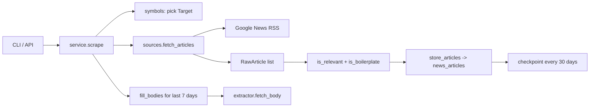

# News — how it works

## The big picture

## One stock, one window

`scrape(symbol, days)` covers a single symbol over `days` look-back days.
The window is sliced **one day at a time** because a single wide query
silently truncates — measured on RELIANCE, one 7-day query returned 9
headlines versus 32 from seven 1-day queries.

## The query ladder

For each day, `sources.fetch_articles` tries up to three rungs, most
precise first:

1. `"<NSE name without suffix>" NSE`
2. `"<app display name>" stock India`
3. `<bare symbol> shares NSE`

Each rung is recorded per article (`query_used`) so a bad match can be
traced. Rungs widen only when an earlier rung returns nothing for that
day window.

## Relevance filter

`service.is_relevant` keeps an article only if it contains at least one of
the target's **distinctive tokens** (derived from the company name, with
generic words like "bank", "india", "limited" stripped). This is what
prevents an Adani-group headline from landing under every Adani entity.

`service.is_boilerplate` drops obvious non-news (price tickers, "stock at
INR …", etc.).

## Checkpointing

The day window is grouped into 30-day chunks (`_day_chunks`). After each
chunk, `store_articles` commits the deduped rows inside a transaction.
If Google News starts returning 503 mid-run, the abort fires after 5
consecutive failures and everything in completed chunks is already saved.
Re-running the identical command skips already-stored days via
`ON CONFLICT DO NOTHING`.

## Rate limiting

`sources.configure_rate_limit` paces requests (default ~20/min). On a
503/429 the client retries with exponential backoff; 5 consecutive
failures abort the run (exit code 3).

## Body extraction

No feed carries article text. Bodies are fetched only for articles published
in the last 7 days (`BODY_FILL_DAYS`), via `extractor.fetch_body`, which
resolves the Google News redirect and pulls the publisher page. A `null`
body is normal, not an error.

## Dedupe

`content_hash` = sha256 of the normalised title (lowercased, publisher suffix
and punctuation stripped). `(content_hash, symbol)` is UNIQUE, so
re-running is free and idempotent.

## Sentiment

Scoring is a separate pass (`scripts.score_sentiment --score --aggregate`)
using FinBERT (`prosusai/finbert`) with a 70/30 keyword blend, over titles
only. Results land in `news_article_sentiment`, aggregated into
`news_sentiment_period` (1M / 3M / 1Y / 3Y) with aligned price series
from yfinance. Exposed via `GET /api/v1/news/sentiment/{symbol}/trend`.
