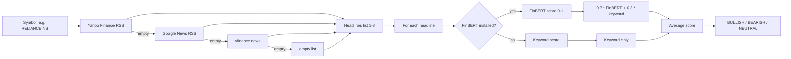

# Sentiment — what it is

The sentiment module measures **how bullish or bearish the mood is** around a
stock. Two flavours:

- **News sentiment** — what financial headlines say about the company.
- **Technical sentiment** — how the chart indicators lean (separate from the
  rule-based verdict in `signals`).

Both feed into the 3-layer signal fusion as the "news" layer (15% weight).

## What you can do with it

- **Get everything at once** with `GET /sentiment/insight` — the endpoint the
  frontend uses. It serves the **stored** sentiment when the stock has any (our
  archive of scored headlines, with the 1M/3M/1Y/3Y breakdown, the strongest
  stories and the recent articles) and falls back to a **live** scrape for a
  stock we have never scraped.
- **Tell the two apart** — the response carries `isStoredData: bool`. `true`
  means the numbers came from the archive, `false` means they were fetched and
  scored just now.
- **Check whether FinBERT is available** — the live path reports
  `finbert_available: bool`. When `false`, it falls back to pure keyword
  scoring.

`GET /sentiment/news` and `GET /sentiment/score` are **deprecated**: their
controllers are commented out in the router and the routes answer with a short
notice pointing at `/sentiment/insight`.

## Where the stored numbers come from

The news module keeps a separate database of scraped articles and the FinBERT
score of each one. From that it builds two summary tables in the main
database:

| Table | What it holds |
|---|---|
| `stock_news_sentiment` | One row per stock: overall score, positive/neutral/negative counts, and the five strongest positive and negative stories. |
| `news_sentiment_period` | One row per stock per window (1M/3M/1Y/3Y): score, counts, how much the tone moved, and the price change over the same days. |

A stock with no row in those tables has no stored sentiment, and the endpoint
says so rather than reporting a neutral score it never measured.

## How news sentiment works



Three-tier headline fallback:

1. **Yahoo Finance RSS** — primary source, India-specific (`region=IN&lang=en-IN`).
2. **Google News RSS** — if Yahoo returns nothing, search for
   `"{ticker} stock NSE India"`.
3. **yfinance `.news`** — last resort.

Each tier is best-effort. Failures are caught silently and the next tier is
tried. Only the first tier with results contributes.

### Per-headline scoring

When FinBERT is installed (default if you have `transformers`):

- FinBERT returns `(label, score)` where label is `positive` / `negative` /
  `neutral` and score is confidence 0–1.
- The numeric value is `lmap[label] * confidence` → in `[-1, +1]`.
- Final headline score = `0.70 × FinBERT + 0.30 × keyword`.

When FinBERT is not installed (lighter deployments):

- Pure keyword scoring against `BULL_WORDS` / `BEAR_WORDS` lists (~150 words
  total, India-specific — SEBI, RBI, NPA, ED notice, etc.).
- Result = `(bull_count − bear_count) / total_matches`.

### Aggregate label

Average of all per-headline scores:

| Average | Label |
|---|---|
| > +0.08 | `BULLISH` |
| < −0.08 | `BEARISH` |
| otherwise | `NEUTRAL` |

## How technical sentiment works

Ten indicator rules, each contributing a weighted score. Final score is
normalised to `[-1, +1]` by dividing by `7.0` (the maximum possible sum).

| # | Rule | Bullish | Bearish | Weight |
|---|---|---|---|---|
| 1 | RSI | < 30 (+0.7), 55–70 (+0.3) | > 70 (−0.6), < 45 (−0.3) | ±0.3–0.7 |
| 2 | MACD crossover | bullish cross (+0.9), above signal (+0.4) | bearish cross (−0.9), below (−0.4) | ±0.4–0.9 |
| 3 | SMA 20/50 | golden cross (+1.0), above (+0.4) | death cross (−1.0), below (−0.4) | ±0.4–1.0 |
| 4 | Price vs SMA-20 | +3% above (+0.4) | −3% below (−0.4) | ±0.4 |
| 5 | Bollinger | above upper (+0.6), upper half (+0.2) | below lower (−0.6), lower half (−0.2) | ±0.2–0.6 |
| 6 | Volume | 1.5× avg AND up day (+0.7) | 1.5× avg AND down day (−0.7) | ±0.7 |
| 7 | 1-day momentum | > +2% (+0.5) | < −2% (−0.5) | ±0.5 |
| 8 | ATR | — | > 3% (high vol, −0.2) | −0.2 |
| 9 | 5-day return | > +5% (+0.5) | < −5% (−0.5) | ±0.5 |
| 10 | 21-day return | > +10% (+0.5) | < −10% (−0.5) | ±0.5 |

Maximum possible bullish score is +7.0. Scores are clipped to `[-1, +1]`.

This is **separate** from the rule engine in `signals.service.compute_signal`.
The signals rule engine uses integer thresholds (±2 to ±4 weights) for a binary
verdict. The sentiment rule engine uses smaller decimal weights for a continuous
mood.

## A real example

You open TCS. The `/sentiment/insight` endpoint returns the stored archive:

```json
{
  "symbol": "TCS.NS",
  "isStoredData": true,
  "source": "stored",
  "news": {
    "score": 0.1124,
    "label": "BULLISH",
    "article_count": 891,
    "counts": {"positive": 303, "neutral": 372, "negative": 216},
    "avg_confidence": 0.71,
    "window": {"start": "2024-01-10T00:00:00+00:00", "end": "2026-10-05T00:00:00+00:00"},
    "detail": [
      {"headline": "TCS Q2 results: Net profit up 1.4%", "label": "positive", "conf": 0.97, "score": 0.97},
      ...
    ]
  },
  "technical": {
    "score": 0.07,
    "label": "NEUTRAL",
    "raw_score": 0.5,
    "signals": [
      {"name": "MACD", "tone": "BULLISH", "message": "MACD above signal", "weight": 0.4},
      {"name": "5D Trend", "tone": "BULLISH", "message": "5-day return +6.2%", "weight": 0.5},
      ...
    ]
  },
  "periods": {
    "1m": {"period": "1m", "title": "1M", "available": true, "score": 0.0345, "label": "NEUTRAL", "article_count": 45, "sentiment_change": -0.0032, "price_change_pct": -8.36},
    "3m": {"...": "..."},
    "1y": {"...": "..."},
    "3y": {"...": "..."}
  },
  "top_articles": [{"id": 10618, "title": "TCS Q2 results…", "source": "Upstox", "score": 0.9681, "label": "BULLISH"}],
  "top_positive": [{"...": "..."}],
  "top_negative": [{"...": "..."}],
  "model_version": "prosusai-finbert",
  "updated_at": "2026-10-07T16:10:00+00:00"
}
```

For a stock with no stored coverage the same endpoint returns the live scrape
with `"isStoredData": false`, no period cards and no stored stories.

The signals fusion picks the news layer up from the same stored tables (15%
weight).

## What the frontend does with it

- **News panel**: shows the mood meter, and where the number came from — the
  archive ("891 scored articles, 10 Jan 2024 – 05 Oct 2026") or a live scrape.
- **News over time**: the 1M / 3M / 1Y / 3Y cards, each with the story count,
  the tone, how much the news moved and how the price moved over the same
  days.
- **Biggest stories**: the five strongest positive and negative stories, with
  their source and date.
- **Headlines panel**: the latest stored articles with tone badges (live
  headlines when the stock is not archived yet).
- **Fusion panel**: the news layer is shown as a 15%-weighted segment of the
  BlendBar gauge.

## Where it lives in the codebase

- Backend code: `backend/app/modules/sentiment/`
- Backend dev notes: `backend/docs/sentiment/`
- Optional: `transformers` + `ProsusAI/finbert` (~440 MB download)
- Frontend API client: `frontend/lib/api/sentiment.ts`
- Frontend hook: `frontend/lib/hooks/use-sentiment.ts`
- Consumer: signals fusion (`signals.service.get_fusion`)

## Consumed by (frontend pages and other modules)

- [Stock terminal](../../pages/stock-terminal/overview.md) — the news card. Each headline
  is scored and the aggregate mood is shown as a coloured badge.
- [Dashboard](../../pages/dashboard/overview.md) — the recent-news ticker.
- Module: [Signals](../signals/overview.md) — fusion reads the stored news
  sentiment for the 15% news weight in the verdict.
- Module: [News](../news/overview.md) — the scraper and the stored archive this
  module reads.

## Related pages in this folder

- [How it works](how-it-works.md) — RSS parsing, FinBERT loading, keyword scoring,
  the ten-rule engine, threadpool usage.
- [Implementation](implementation.md) — file map, every function, the optional
  FinBERT import, frontend wiring.